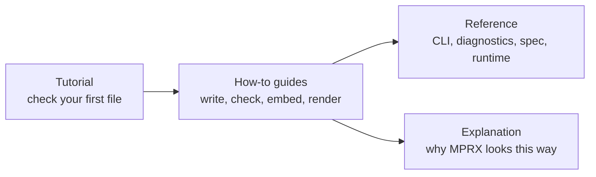

# MESH documentation

> **TL;DR:** MESH is the compiler and runtime for MPRX, the language that describes a user interface as data. Start with *Getting started* to check your first file; the rest is here when you need it.

## Prerequisites

* A terminal, to install the `mesh` command. JavaScript users can use the npm packages instead.

---

## Where to go

## Tutorial

- [**Getting started**](tutorials/01-getting-started.md): install `mesh`, write and check your first file, and read diagnostics.

## How-to guides

- [**Writing MPRX**](how-to/writing-mprx.md): everything the language supports, with common mistakes and their fixes.
- [**Checking against a component model**](how-to/checking-against-a-component-model.md): declare your components in a manifest and check what a file means, not just its shape.
- [**Editor setup**](how-to/editor-setup.md): diagnostics, hover, go to definition, completion and highlighting in your editor.
- [**Using MESH from JavaScript**](how-to/using-mesh-from-javascript.md): check MPRX in Node or a browser with `@valancex/mesh-compiler`, and a generate-check-repair loop.
- [**Embedding the compiler**](how-to/embedding-the-compiler.md): call MESH from Rust, handle diagnostics, and walk the Semantic IR.
- [**Integrating MESH with NEXUS**](how-to/integrating-mesh-with-nexus.md): build a host that renders from your state and maps intents to commands.
- [**Rendering MESH output**](how-to/rendering-mesh-output.md): build a renderer that realizes a render tree, reports events and updates by key. Its [conformance vectors](../examples/conformance/README.md) test one without a target.

## Reference

| Page | What it answers |
|---|---|
| [`mesh` CLI](reference/mesh-cli.md) | Commands, output streams, diagnostic formats, exit codes |
| [`mesh-lsp`](reference/mesh-lsp.md) | The language server: installing, configuring, what it publishes when |
| [Diagnostics](reference/diagnostics.md) | Every diagnostic code, its cause and its fix |
| [Component manifest](reference/manifest.md) | The manifest format, version 1 ([JSON Schema](../schemas/manifest-v1.schema.json)) |
| [MPRX language spec](reference/mprx-spec.md) | The canonical grammar and semantics |
| [Templates and programs](reference/templates.md) | The compiled form of a template and the assembly rules ([JSON Schema](../schemas/template-v1.schema.json)) |
| [The MESH runtime](reference/runtime.md) | Render and dispatch, the render tree, keys, intents, runtime diagnostics |
| [Streaming](reference/streaming.md) | Checking MPRX as a model writes it |
| [API stability](reference/stability.md) | What each public surface promises |
| [Release notes](reference/releases/) | Each version in full; the [changelog](../CHANGELOG.md) is the summary |

<b>Normative data and schemas</b>

* [Evaluation and the boundary](reference/mprx-spec.md#97-evaluation): §9.7 and §9.8 of the spec, with the normative [number-to-text table](reference/tables/number-to-text.tsv) and its [reference generator](reference/tables/number-to-text.py).
* JSON Schemas: [diagnostics](../schemas/diagnostics-v1.schema.json), [render trees and intents](../schemas/render-v1.schema.json), [runtime diagnostics](../schemas/runtime-diagnostics-v1.schema.json).
* [Glossary](https://github.com/ValanceX/Valance/blob/main/docs/reference/glossary.md): words that mean different things across the Valance repos, and the canonical name for each.

## Explanation

- [**Architecture**](explanation/architecture.md): why MPRX looks the way it does, and how MESH fits into Valance.
- [**API design principles**](explanation/api-design-principles.md): the rules public APIs across the ecosystem are held to.
- The design record: [specs](explanation/specs/) and [implementation plans](explanation/plans/) that MESH was built from. Not needed to use MESH.

## Next steps

* [Getting started](tutorials/01-getting-started.md).
* Working on MESH itself? See [Contributing](../CONTRIBUTING.md).
